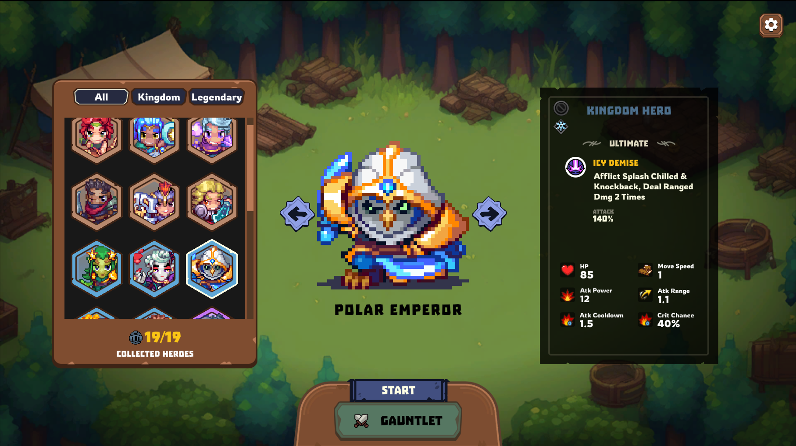
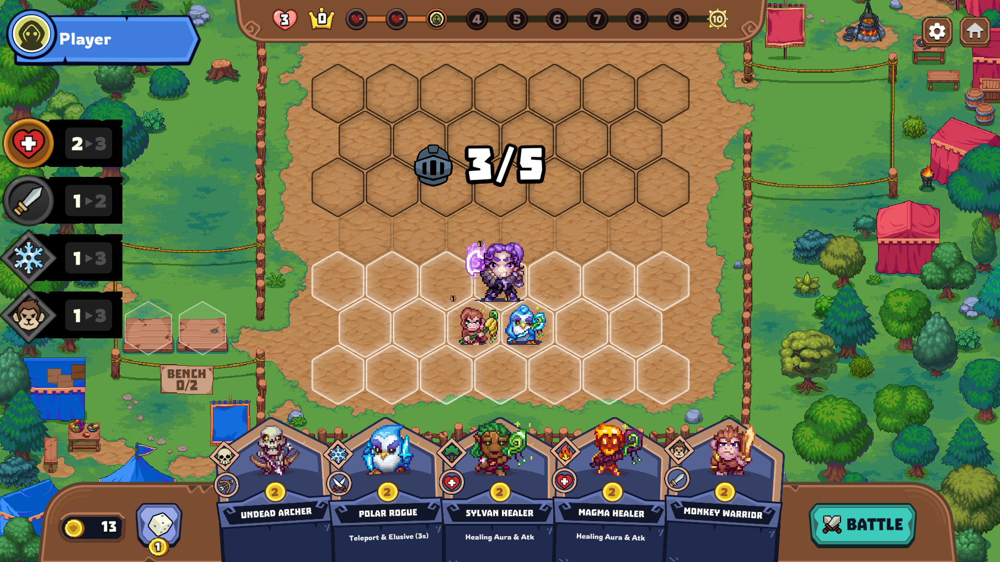
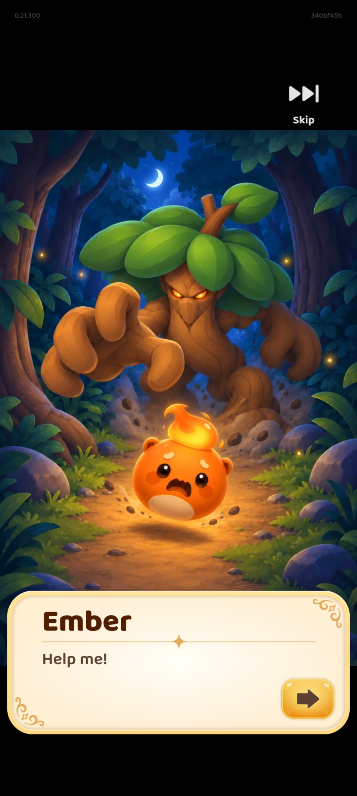
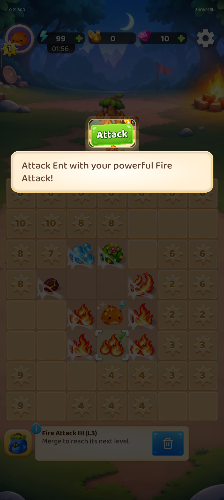
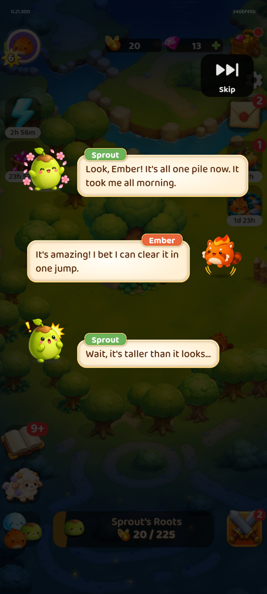
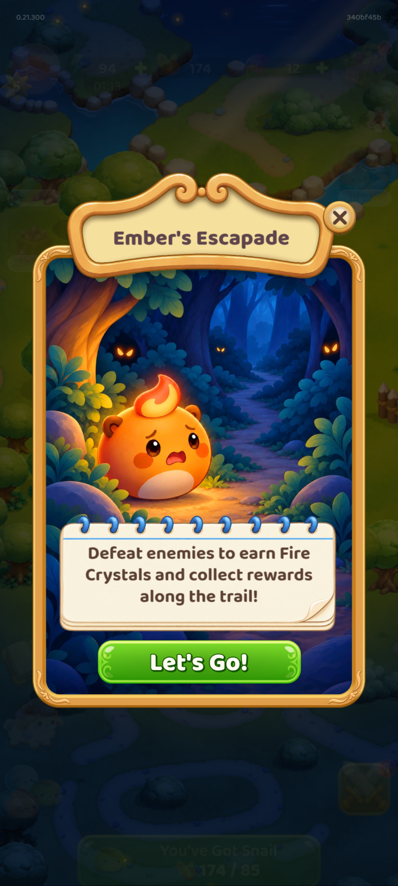
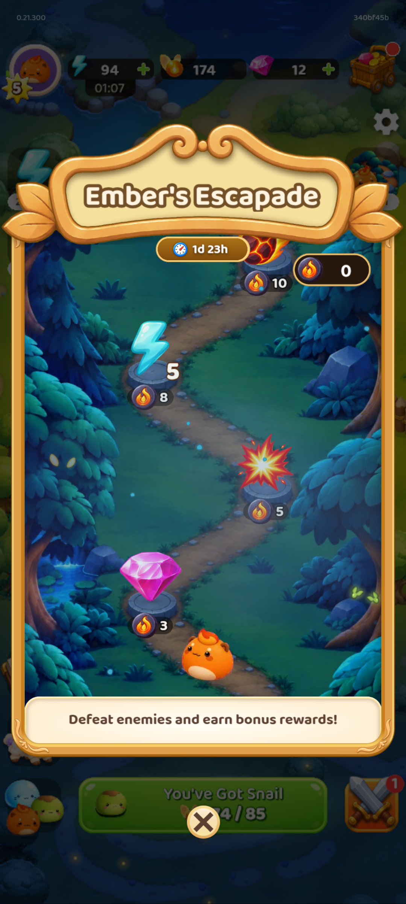

# Ehow Chen's Game Design Portfolio
Some sample screenshots of game titles I worked on as a game designer! (A work in progress.)

#### [Arena Kingdoms](https://www.youtube.com/playables/UgkxJmwg98icsWuce6d-z6eVUYILlovTRw86)
* Originally a Discord title, now exists as a Youtube Playable.
* Designed all aspects of the game, including: core loop, kingdoms, units, unit balance, metagame progression, season pass

#### Mergemon Wilds
* Designed tutorials, narrative system, narrative, live ops events

#### Unreleased Top-Down Shooter (2026)
* Designed combat mechanics, metagame progression, levels, enemies

